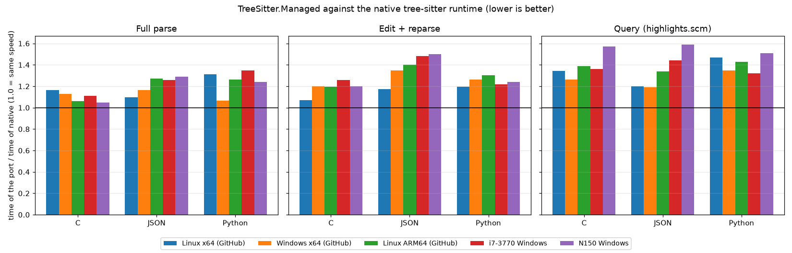

# Benchmarks

TreeSitter.Managed against the native tree-sitter runtime v0.27.2, built from the same
sources as the oracle of the tests (`tools/build-oracle.sh`, clang or gcc `-O2`). Both run
in the same process on the same input (`bench/TreeSitter.Managed.Benchmarks`,
BenchmarkDotNet, ShortRun), and every benchmark first checks that both sides give the same
result. The native time includes one P/Invoke call per operation. Each side deletes or
disposes the trees it creates.

- Full parse: `lib/src/query.c` of the runtime (C, 170 KB), 1500 generated JSON objects
  (0.3 MB), 300 generated Python classes (0.25 MB).
- Edit + reparse: one byte in the middle replaced by itself, the tree copied, edited and
  reparsed with the old tree.
- Query: all captures of the grammar's `highlights.scm` over the parsed input.



Time of the port divided by the time of native (1.00 is the same speed, lower is better).
GitHub columns are the mean of two runs of the `bench` workflow; the last two columns are
desktop machines (Intel Core i7-3770, Intel N150), .NET 10.

| Operation | Grammar | Linux x64 (GitHub) | Windows x64 (GitHub) | Linux ARM64 (GitHub) | i7-3770 Windows | N150 Windows |
|---|---|---:|---:|---:|---:|---:|
| Full parse | C | 1.17 | 1.13 | 1.06 | 1.11 | 1.05 |
| Full parse | JSON | 1.10 | 1.17 | 1.27 | 1.26 | 1.29 |
| Full parse | Python | 1.31 | 1.06 | 1.27 | 1.35 | 1.24 |
| Edit + reparse | C | 1.07 | 1.20 | 1.19 | 1.26 | 1.20 |
| Edit + reparse | JSON | 1.18 | 1.35 | 1.40 | 1.48 | 1.50 |
| Edit + reparse | Python | 1.19 | 1.27 | 1.31 | 1.22 | 1.24 |
| Query (highlights.scm) | C | 1.34 | 1.26 | 1.39 | 1.36 | 1.57 |
| Query (highlights.scm) | JSON | 1.20 | 1.19 | 1.34 | 1.44 | 1.59 |
| Query (highlights.scm) | Python | 1.47 | 1.35 | 1.43 | 1.32 | 1.51 |

## Before and after 1.0.0

0.1.0 kept the C memory model with one object per node. 1.0.0 stores the nodes in an arena
of structs (docs/ARENA.md). The full parse of C went from 1.85-2.08 times the native time to
1.05-1.17, JSON from 2.31-2.88 to 1.10-1.29, Python from 1.80-2.31 to 1.06-1.35; a parse of
`query.c` allocates about 1 MB instead of 14 MB.

## Where the time goes

The lexer is faster than native and the parse tables are at native speed. The remaining
difference is mostly in the parse stack (its nodes are still objects; moving them into the
arena is the next step, docs/ARENA.md), in the reuse of the old tree during an incremental
parse, and in the query cursor.

To run the benchmarks:

```
bash tools/build-oracle.sh
dotnet run -c Release -f net10.0 --project bench/TreeSitter.Managed.Benchmarks -- --filter "*RuntimeBenchmarks*" --job short
```

The chart and the table are built by `tools/bench-chart.py` from the BenchmarkDotNet logs.
